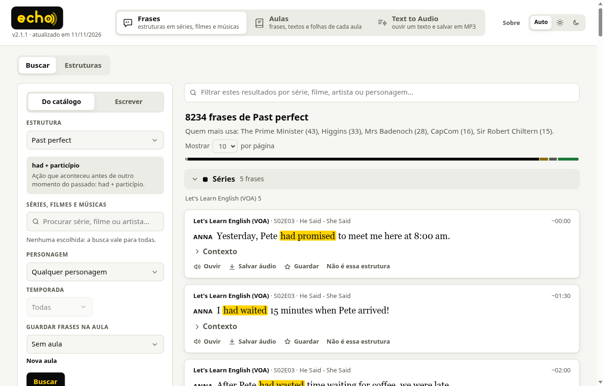
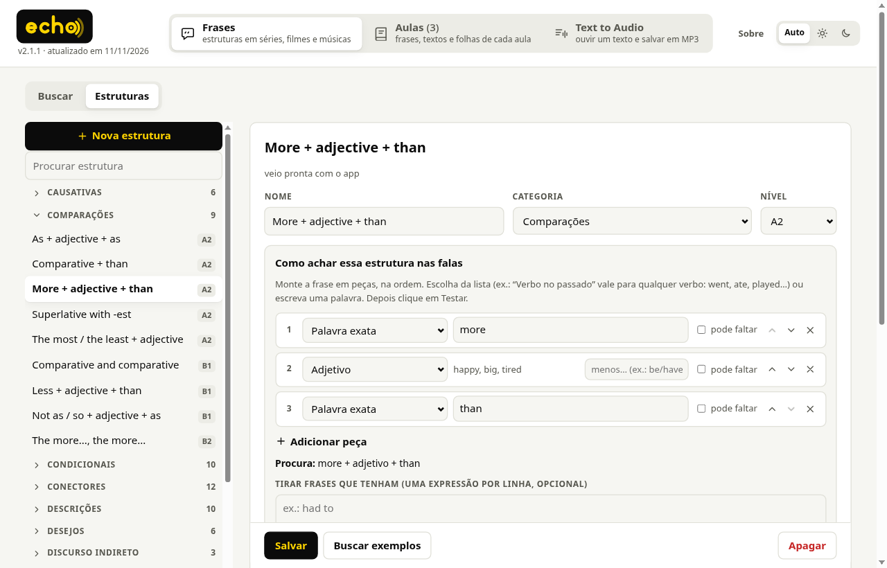
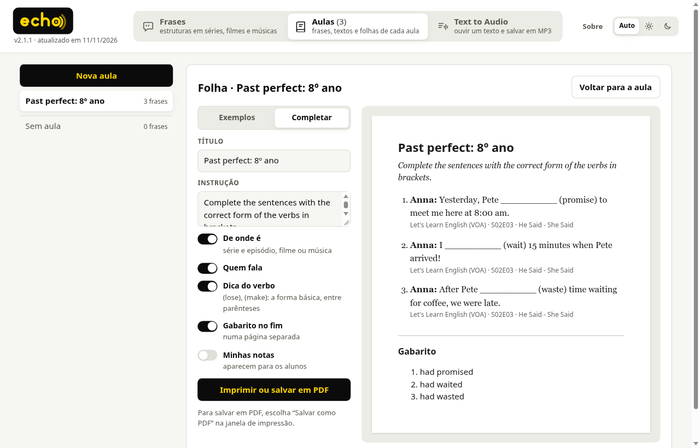
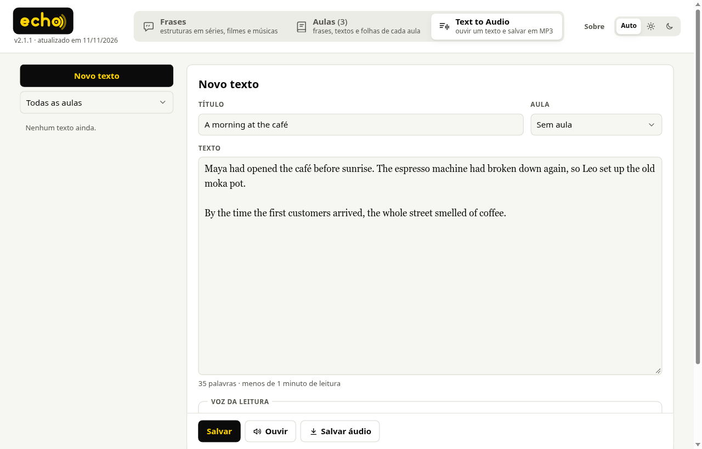

# Echo

App de desktop para professora de inglês montar material de aula com **frases reais em inglês**, achadas
pela **estrutura gramatical**: "me mostre falas com *past perfect*", "*second conditional*", "*phrasal
verbs* com *up*". As frases encontradas vão para uma aula, viram folha de exercício (exemplos ou
completar a lacuna, com gabarito) e podem ser ouvidas ou salvas em áudio.

Vem com um **acervo livre**: peças e romances em domínio público (Wilde, Shaw, Austen, Dickens, Twain,
Conan Doyle…), os diálogos das aulas da VOA, conversas reais da NASA e do Parlamento britânico, frases
do Tatoeba com tradução, dois curtas abertos da Blender e canções antigas. E busca também nos **seus
próprios textos**.

Foi feito para uso real de uma escola de inglês, num PC com Windows 11 bem travado: roda tudo local,
sem servidor, sem conta e sem custo.



| Estruturas montadas com peças | Folha de completar com gabarito | Text to Audio |
|---|---|---|
|  |  |  |

## O que ele faz

- **Frases**: 186 estruturas prontas (tempos verbais, condicionais, comparações, modais, voz passiva,
  discurso indireto, phrasal verbs…), filtro por obra, personagem e temporada, contexto da cena. Dá
  para criar estruturas próprias juntando **peças** ("Alguém ou algo" + "Verbo no passado" + "Palavra
  exata") ou escrever a busca em inglês ("give up", "used to").
- **Aulas**: as frases guardadas, com nota por frase, e a **folha** para imprimir ou salvar em PDF.
- **Text to Audio**: textos da professora lidos pelas vozes do Windows e salvos em MP3.
- Clique numa palavra para ver a tradução (dicionário tirado do Wiktionary).

## Acervo e direitos autorais

O acervo que vem junto (`acervo/`, ~38 obras e 240 mil frases do Tatoeba) só tem o que é livre **no
Brasil e nos EUA**: obra em domínio público, obra do governo dos EUA ou conteúdo com licença aberta
(CC BY, Open Parliament Licence). A lista completa, com autor, fonte e licença de cada uma, está em
[ACERVO.md](ACERVO.md).

Os trechos são para uso didático: cite a obra de onde vieram e não revenda o material.

**Seus textos:** importe só textos de sua autoria ou que você tenha direito de usar. O Echo não fornece
conteúdo protegido e não se responsabiliza pelo que for importado nem pelo uso dos trechos fora de fins
didáticos.

## Stack

- **Python 3.12+ só com a biblioteca padrão** no app: o PC de destino só roda programa assinado, então
  vai junto o Python *embeddable* do python.org e nada de pacote de terceiros.
- **SQLite**: o banco de frases (só leitura), `dados.db` (aulas, estruturas, cache; migrações
  numeradas com `PRAGMA user_version`) e um índice **FTS5** montado no primeiro uso.
- **spaCy** (`en_core_web_sm`) e **ftfy** só na hora de gerar o banco: cada frase é guardada como
  `palavra/lema/TAG`, e as estruturas são padrões sobre essas etiquetas.
- Interface em **HTML, CSS e JavaScript puros** (módulos ES, sem build), servida em `127.0.0.1` e
  aberta no **Edge em modo aplicativo**.
- Áudio pela **SAPI** e conversão para MP3 pelo **Media Foundation**, chamados via `ctypes`.
- Servidor **MCP** opcional (`app/mcp_server.py`) para buscar as frases a partir do Claude.
- Atualização pelo próprio app, a partir de releases de um repositório GitHub (`ferramentas/publicar.py`).

## Rodar

Precisa de Python 3.12 ou mais novo. O acervo já vem pronto:

```sh
python3 -I app/janela/app.py              # Windows: abre no Edge
python3 -I app/janela/app.py --navegador  # qualquer sistema: abra no navegador o endereço que ele mostra
```

Os dados do app (aulas, estruturas) ficam fora do repositório: `%APPDATA%\FrasesSeries` no Windows,
`~/.local/share/frases-series` no Linux. Para a aba Sobre mostrar um contato, copie
`app/contato.example.json` para `app/contato.json`. Para receber atualizações por GitHub, o app procura
`app/github.json` (`{"repo": "dono/nome", "token": "..."}`); sem ele, essa parte só fica desligada.

Buscar direto no terminal: `python3 -I ferramentas/buscar.py --estrutura "past perfect"` (`--help` para
os filtros e a linguagem de padrões).

## Usar os seus textos

1. Ponha os textos em `transcripts/<nome-da-pasta>/`, um `.txt` por episódio (`S01E01 - Título.txt`)
   ou por filme, no formato `Personagem: fala` (linhas `Scene: …` e rubricas entre parênteses são
   reconhecidas; legenda sem nome de quem fala também serve). Use `transcripts/cafe-da-esquina/` (um
   diálogo inventado) como modelo.
2. Cadastre cada pasta em `ferramentas/obras.json` (nome, tipo `serie`/`filme`/`musica`, ano, duração).
3. Gere o banco:

   ```sh
   python3 -m venv .venv
   .venv/bin/pip install spacy ftfy
   .venv/bin/python -m spacy download en_core_web_sm
   .venv/bin/python -I ferramentas/indexar.py        # grava corpus.db na raiz
   ```

4. Abra o app: com um `corpus.db` na raiz (ou em `app/`), ele usa o seu banco no lugar do acervo. No
   app instalado, o `corpus.db` também entra pela aba Sobre › Atualizar › Escolher arquivo.

O acervo é refeito do mesmo jeito, a partir das fontes: veja "Como refazer" no [ACERVO.md](ACERVO.md).

## Testes

Scripts em `ferramentas/testar_*.py`, sem framework, com a biblioteca padrão (por exemplo
`python3 -I ferramentas/testar_aulas.py`, `testar_atualizacao.py`, `testar_textos.py` e
`testar_audio.py`).

## Estrutura

```
app/
  nucleo/      busca, estruturas e peças, aulas, textos, áudio, índice, migrações, atualização
  janela/      servidor local, abertura no Edge e a interface (ui/: componentes, telas, css)
  mcp_server.py
acervo/        o acervo livre, já convertido (um .txt por capítulo, ato, aula...) e acervo.db
ferramentas/   indexar.py (gera o banco), baixar_acervo.py e converter_acervo.py, buscar.py,
               empacotar.py, publicar.py, testes
transcripts/   seus textos (aqui só o exemplo)
```

## Licença

Código sob a licença [MIT](LICENSE). O dicionário em `app/nucleo/dicionario.json.gz` é derivado do
[Wiktionary](https://en.wiktionary.org/) (via [kaikki.org](https://kaikki.org/)) e segue a licença
[CC BY-SA 4.0](https://creativecommons.org/licenses/by-sa/4.0/). Os textos do acervo seguem a licença de
cada obra ([ACERVO.md](ACERVO.md)).
